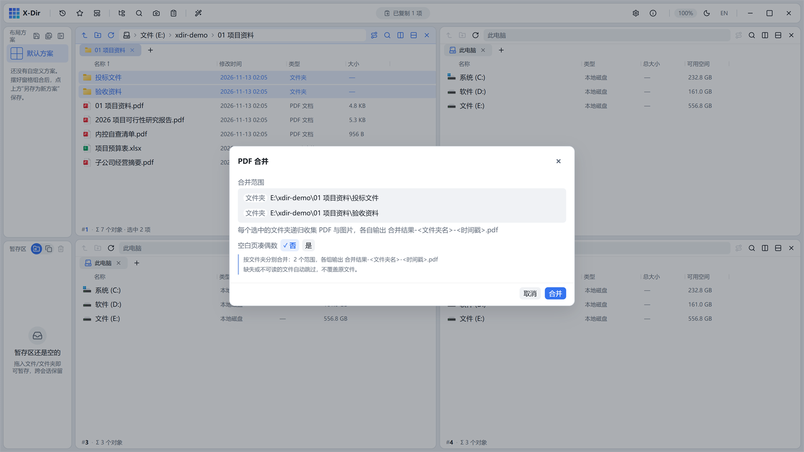

# PDF · 按文件夹合并 PDF

把多个文件夹**各自递归收集**其中的 PDF，分别合成一份。

## 入口

选中 **≥1 个文件夹** → 右键 →「按文件夹合并 PDF」。

## 参数

| 参数 | 说明 |
|---|---|
| 文件夹清单 | 每个文件夹各成一组，输出一份 PDF |
| 输出名 | `合并结果-<文件夹名>-<时间戳>.pdf` |

## 步骤

1. 选中要合并的文件夹（如演示树里的「投标文件」与「验收资料」）；
2. 右键 →「按文件夹合并 PDF」；
3. 确认清单后执行，每个文件夹产出一份独立 PDF。

## 输出与注意

- 递归收集包含子文件夹内的 PDF；
- 输出旁写、绝不覆盖；各组互不影响，某组失败不影响其余；
- 文件夹内混有图片时只收集 PDF（混选图片请用[合并为 PDF](merge.md)）。
