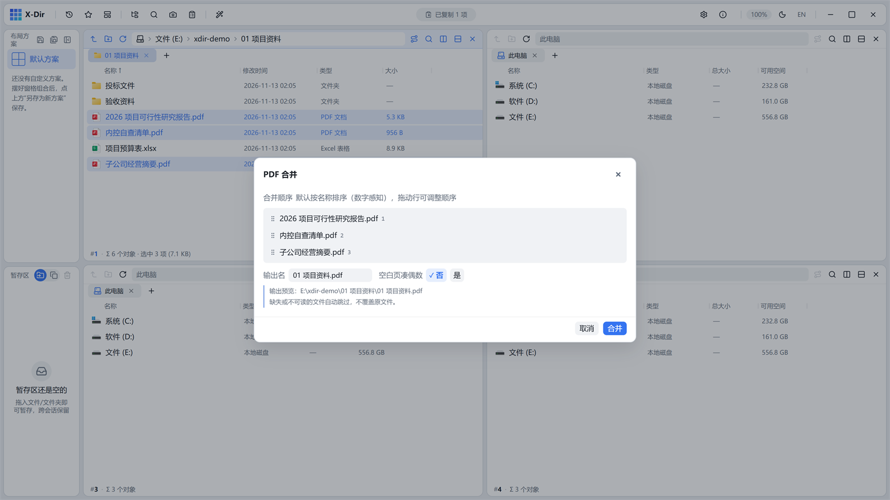
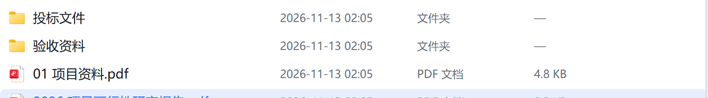

# PDF · 合并为 PDF

把多个 PDF（或图片）按**选中顺序**合成一份 PDF。

## 入口

选中 **≥1 个** PDF/JPG/PNG 文件 → 右键 →「合并为 PDF」（功能库搜索「合并」同效）。

## 参数

| 参数 | 说明 |
|---|---|
| 待处理清单 | 置顶文件列表，**拖动定序**，处理顺序随清单 |
| 输出文件名 | 智能默认：单文件取文件名主干，多文件取所在目录名；重名自动 `(2)` 递增 |

## 步骤

1. 在窗格中按合并顺序选中文件（`Ctrl` 加选，可 PDF 与 JPG/PNG 混选）；
2. 右键 →「合并为 PDF」；
3. 在清单里拖动调整顺序，确认输出名；
4. 点「合并」，进度经灵动岛播报，完成后回执可直达输出目录。

## 输出与注意

- 输出旁写为新文件，**绝不覆盖原件**；
- 缺失的源文件自动跳过并在回执中说明；
- 想把多个文件夹各自合成一份，用[按文件夹合并 PDF](merge-folders.md)；
- 想在合并时给每份凑偶数页（审计底稿双面打印），用「合并扩展」的空白页能力（合并对话框中的空白页选项）。
