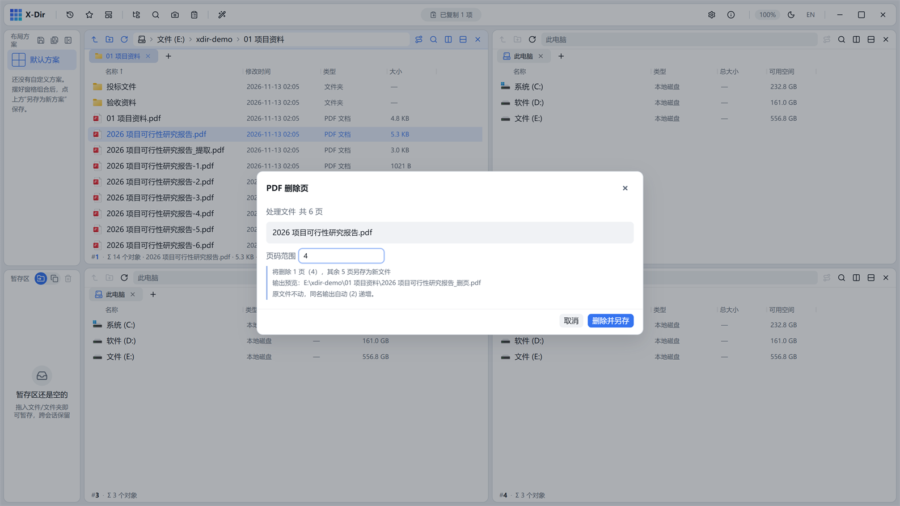

# PDF · 删除页

删除指定页后另存新文件，原文件不动。

## 入口

选中 **1 个 PDF** → 右键 →「PDF 删除页」。

## 页码范围表达式

`1-3,5,8-`（语法与[提取页](extract.md)完全一致）

## 步骤

1. 选中 PDF →「PDF 删除页」；
2. 输入要**删掉**的页码范围；
3. 执行，输出旁写新文件（剩余页按原顺序重排）。

## 输出与注意

- 删除扫描件中的空白页/ Confidential 页是典型场景；
- 输出名自动 `(2)` 递增，绝不覆盖原件；
- 删除后页数不足 1 页时会拒绝执行并提示。
