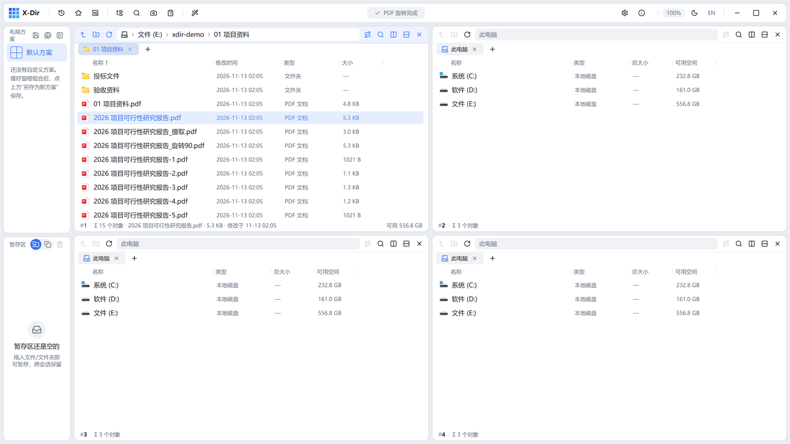

# PDF · 旋转

把 PDF 的全部页旋转，**可逆向还原**。

## 入口

选中 **1 个 PDF** → 右键 →「PDF 旋转 ▸」，三个方向任选：

- 顺时针 90°
- 旋转 180°
- 逆时针 90°

## 步骤

1. 选中 PDF →「PDF 旋转 ▸」→ 选方向；
2. 直接执行（无参数对话框），灵动岛回执完成。

## 输出与注意

- 旋转**旁写**新文件 `<文件名>_旋转<度数>.pdf`，原文件保持不动——再对输出文件反向旋转即可恢复；
- 旋转角度写入页面属性，阅读器/打印均按新方向呈现；
- 扫描件方向统一、合同页横竖混排矫正的常用手段。
