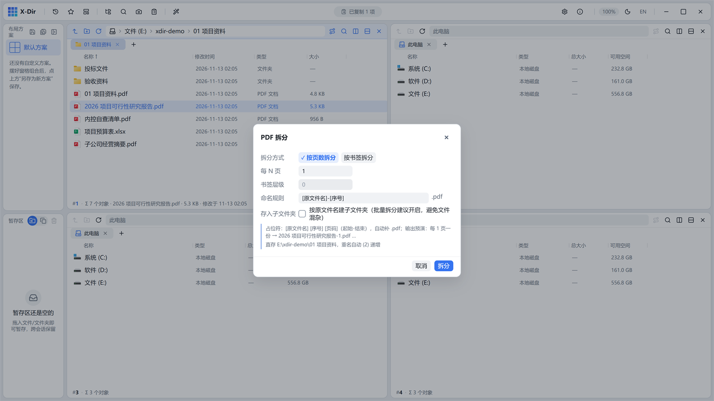
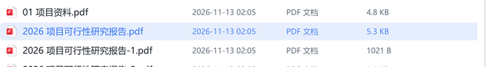

# PDF · 拆分

把一份 PDF 按页数或书签层级拆成多份。

## 入口

选中 **1 个 PDF** → 右键 →「PDF 拆分」。

## 参数

| 参数 | 说明 |
|---|---|
| 拆分方式 | **按页数 N**（每 N 页一份）/ **按书签层级**（0 = 顶级书签；层级无书签时自动取最深，无书签的任务报错） |
| 命名规则 | 占位符 `[原文件名]` `[序号]` `[页码]` 自由组合 |
| 存入子文件夹 | 开（默认）：输出到 `<原文件名>_分页\` 子文件夹；关：直存所在目录 |

## 步骤

1. 选中 PDF →「PDF 拆分」；
2. 选拆分方式并填写参数；
3. 执行后灵动岛播报进度，完成回执可打开输出目录。

## 输出与注意

- 拆分区间为闭区间逐段提取，输出旁写、重名 `(2)` 递增；
- 按书签拆分依赖 PDF 的大纲（书签）信息；
- 只想要某几页，用[提取页](extract.md)；只想去掉某几页，用[删除页](remove.md)。
