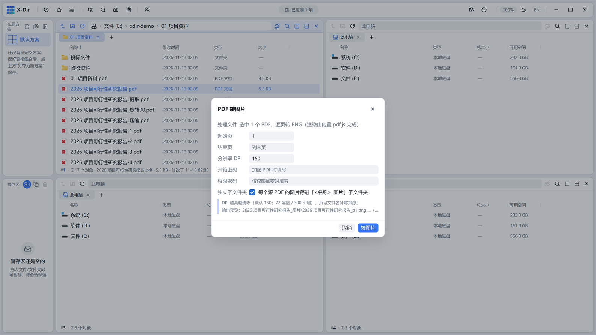

# PDF · 转图片

把 PDF 逐页导出为 PNG 图片。

## 入口

选中 **1 个 PDF** → 右键 →「PDF 转图片」。

## 参数

| 参数 | 说明 |
|---|---|
| 页范围 | 全部 / 自定义 `1-3,5,8-` |
| 分辨率 | 按 DPI 缩放（高于 96dpi 输出更清晰的图片） |
| 加密口令 | 源文件有口令时在此输入 |

## 步骤

1. 选中 PDF →「PDF 转图片」；
2. 设置页范围与分辨率；
3. 执行后每页输出一张 PNG，存入输出目录。

## 输出与注意

- 输出旁写到子文件夹，重名 `(2)` 递增；
- 输出的是**渲染位图**（所见即所得），不可再当矢量 PDF 编辑；
- 反向需求（图片拼 PDF）用[合并为 PDF](merge.md)（支持 JPG/PNG 混选）。
