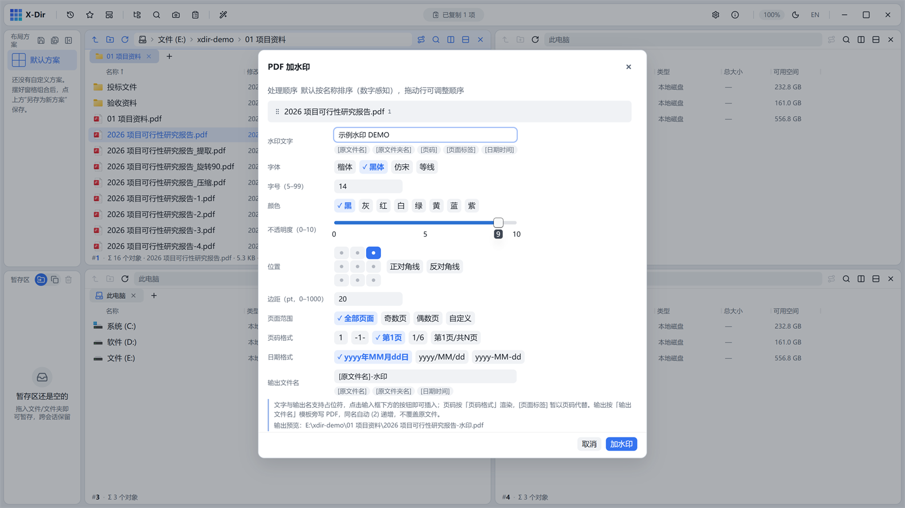

# PDF · 加水印

参数化文字水印：占位符、字体、九宫格定位、不透明度、页范围一应俱全。

## 入口

选中 **PDF 文件** → 右键 →「PDF 加水印」。

## 参数

| 参数 | 说明 |
|---|---|
| 水印文字 | 支持占位符：`[原文件名]` `[原文件夹名]` `[页码]` `[页面标签]` `[日期时间]`（页码 5 种格式、日期 3 种格式可选） |
| 字体 | 楷体 / 黑体 / 仿宋 / 等线（缺失时自动回落系统字体链） |
| 颜色 | 8 色板（黑/灰/红/白/绿/黄/蓝/紫） |
| 位置 | 九宫格边距点（配合字号/边距）或正/反对角线 ±45° 居中平铺；对角线模式字号边距自动禁用 |
| 透明度 | 0–10 滑杆 |
| 页范围 | 全部 / 奇数页 / 偶数页 / 自定义（`1-3,7,10-`） |

## 步骤

1. 选中 PDF →「PDF 加水印」；
2. 输入文字（如「示例水印 DEMO」），选位置与透明度；
3. 点「加水印」，输出旁写 `<原文件名>-水印.pdf`。

## 输出与注意

- 小字号自动 **2–4× 超采样**渲染，放大与打印不发糊；
- 字号/边距为自由输入（单位 pt），非法值即时红字；
- 全部参数经 `dialogPrefs` **跨会话记忆**（下次打开保持上次选择）；
- 想要图片/贴图水印或平铺图案，当前版本建议用[图片加水印](../images/watermark.md)处理源图后再转 PDF。
